# 中国象棋 · 使用教程

一份简单明了的上手说明，照着做就能玩。

## 一、第一次打开

- 首次启动会弹出**注册/激活**窗口。按提示完成激活（扫码或输入激活码）即可进入主界面。
- 软件运行时屏幕会保持常亮，不会自动熄屏。

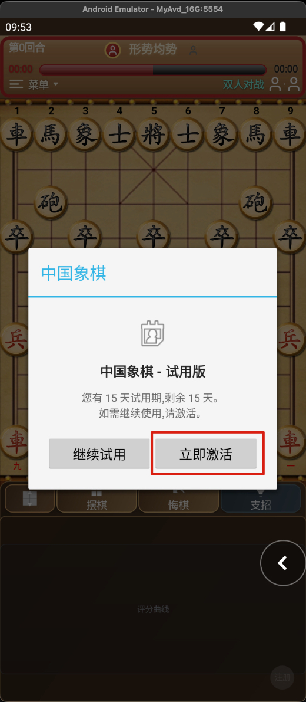
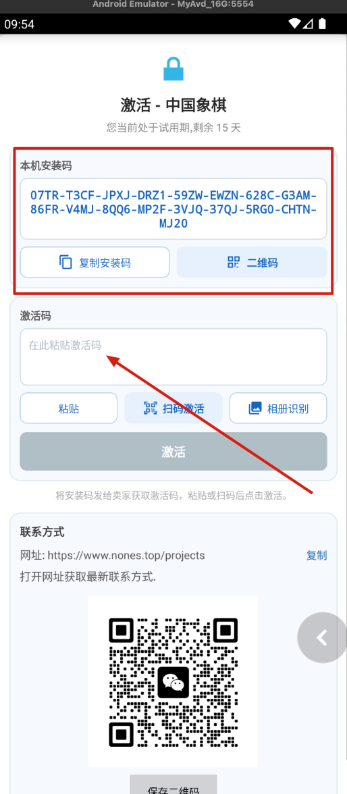
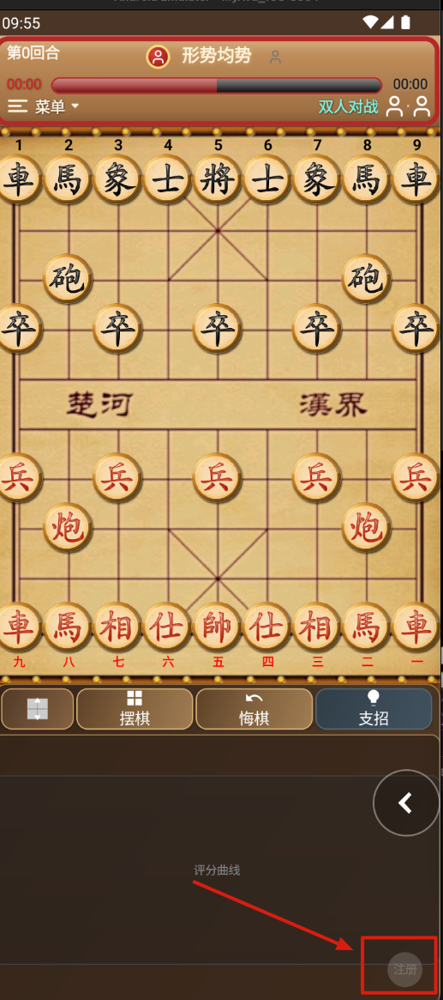

## 二、选择对战模式

右上角的**模式按钮**（图标形式）点一下，会弹出四种模式：

| 模式 | 说明 |
| --- | --- |
| 双人对战 | 同一部手机上两个人轮流下 |
| 玩家执红 | 你执红方，电脑执黑 |
| 玩家执黑 | 你执黑方，电脑执红 |
| 双机对战 | 红黑都由电脑下，你坐旁边看 |

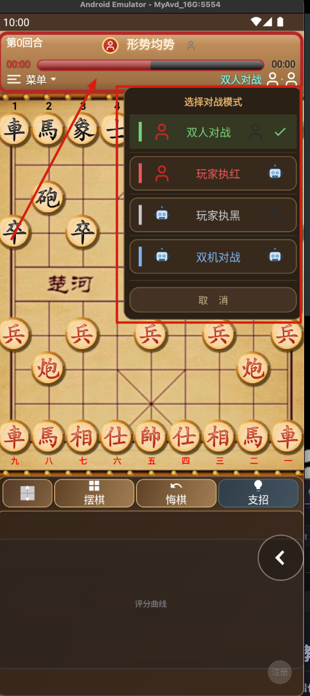

切换模式**不会清空棋盘**，会从当前局面继续。

## 三、怎么下棋

1. **点一下**要走的棋子，会高亮显示它能走的位置。
2. 再**点一下**目标位置，棋子就走过去了。
3. 走法不合法（比如送将、对面将脸对脸）会提示，不会生效。
4. 轮到谁走，底部状态栏会标明。被将军时会弹出"将军"提示。

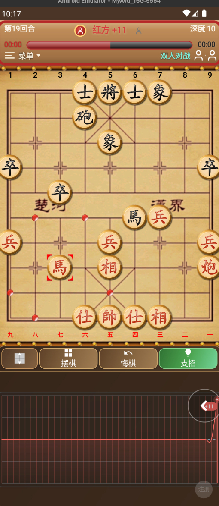

## 四、常用按钮

- **新局**：开一局全新的棋（会确认是否清除当前进度）。
- **悔棋**：退回到上一步。
- **翻转**：把棋盘上下翻转，方便对面的人看。
- **上一步 / 下一步**：一步步回看刚才的走法。
- **支招**：让电脑给你出主意，给出几步好棋和评分。
  - 电脑正在思考时，这个按钮会变成**"中断"**，点它可以让电脑停手。
- **设置**：调整电脑强弱、思考时间、强制变着、音效等（详见第五项）。

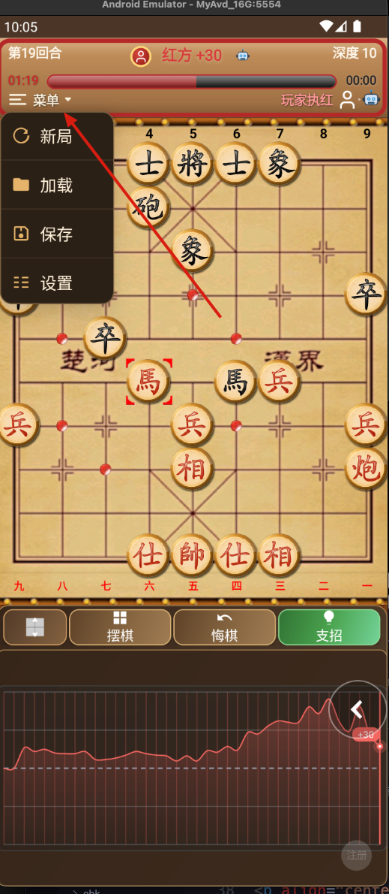

## 五、软件设置的解释

点**设置**按钮打开设置面板，各项含义如下：

- **电脑棋力（技能级别 1–20 级）**：数值越大电脑越强。新手先调低，想认真研究就往高拉；最高 20 级基本是满血状态。
- **思考时间（1–60 秒）**：电脑每走一步允许花费的时间。时间越长、算得越深，但也越慢；设得过高（超过 15 秒）软件会提醒注意手机性能，避免卡死。
- **搜索深度（5–120 层）**：引擎向前推算的层数，越大越强越慢。一般配合思考时间一起调即可。
- **支招变化数（MultiPV 1–5）**：点"支招"时，除了给出最佳着法，还会同时列出几个候选变化方便对比。设为 1 只给一手；≥2 时每多一条变线要额外花搜索时间（软件会提示建议的思考时间）。
- **强制变着（开 / 关）**：遇到长将、长捉、三次重复局面时，自动要求必须变着，符合正式比赛规则；关闭后则只提示、不强制。建议保持开启。
- **难度预设（初级 / 高手 / 解题 / 飘逸）**：一键套用成套参数，省去逐项调滑块。点一下即把"思考时间 / 搜索深度 / 技能级别 / MultiPV / 强制变着"全部设好：
  - **初级**：1 秒 / 5 层 / 1 级 / MultiPV 1，强制变着**开**——轻松耍两下。
  - **高手**：3 秒 / 20 层 / 10 级 / MultiPV 1，强制变着**开**——正经对弈。
  - **解题**：5 秒 / 60 层 / 20 级 / MultiPV 1，强制变着**关**——残局研究，可重复局面多试变化。
  - **飘逸**：10 秒 / 120 层 / 20 级 / MultiPV 3，强制变着**关**（红字提示：计算量极大，可能卡顿，请斟酌手机性能）。
- **背景音乐（开 / 关）**。
- **音效（开 / 关）**：走子、吃子、将军等操作的提示音。

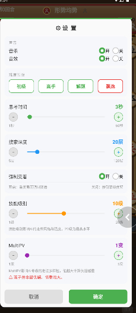

所有设置会**自动保存**，下次打开软件仍然生效；改完点"确定"即可，对当前和之后的对局都有效。

## 六、拍照 / 相册识谱（最省事的功能）

看到书上的残局、网上的棋图，不用手动摆：

1. 先点**摆棋**进入摆棋模式。
2. 摆棋面板下方有三个按钮：**清空棋盘 / 拍照 / 图片**。
   - **拍照**：直接拍一张棋盘照片。
   - **图片**：从相册里选一张棋图。
3. 软件会自动识别棋盘和棋子，并摆好，连子都不用你动手。
4. 摆好后退出摆棋模式即可从当前局面开始下。

> 提示：照片尽量拍正、光线好，识别更准。

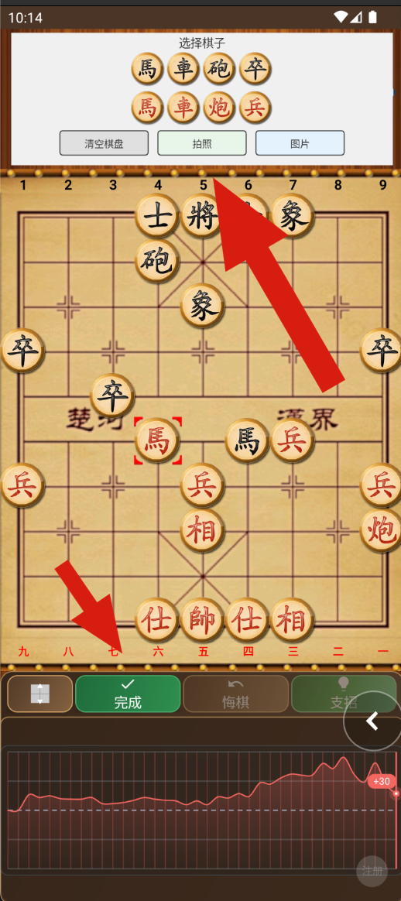

## 七、自由摆棋

自由摆棋可以自己摆出想研究的残局，再开始对弈或复盘。

1. 点底部 **摆棋** 进入摆棋模式（按钮变为 **"完成"**），下方出现"选择棋子"面板。
2. 在面板点要摆的棋子，再点棋盘格子放下；点已摆的棋子可移动或（点原格）移除。
3. 规则有限制：将/帅只在九宫、士走斜线、象/相不过河；数量上每方将帅 1 个、士/象/车/马/炮各 2 个、兵/卒各 5 个。
4. 面板下方可 **清空棋盘** 重来，或用 **拍照 / 图片** 识别棋图自动摆好（详见第六项）。
5. 双方都摆好将/帅后点 **"完成"**，选择"红方开始"或"黑方开始"，即从该局面开下（默认双人对战，可随时切换模式）。

**小提示**

- 摆棋过程中可随时点"拍照/图片"把书上的棋图识别进来，再手工微调。
- 摆好的局面会作为新开一局，之前加载的棋谱 / 回放状态会被清空。

## 八、棋谱的保存与回看

- **保存**：把当前这盘棋存成棋谱文件，随时能找回。
- **加载**：打开棋谱列表，选一局加载进来继续下或复盘。
- 加载后可以用"上一步 / 下一步"慢慢回放，研究哪步妙、哪步臭。
- 加载的棋谱里，你也可以手动接管继续往下走。

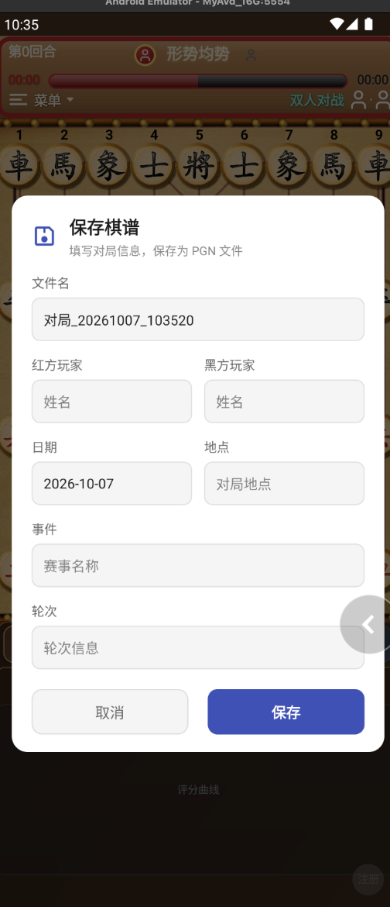

## 九、评分曲线

对局过程中底部会有一条**评分曲线**，把整盘棋谁占优势画得清清楚楚，红高黑低一眼可见，方便复盘。

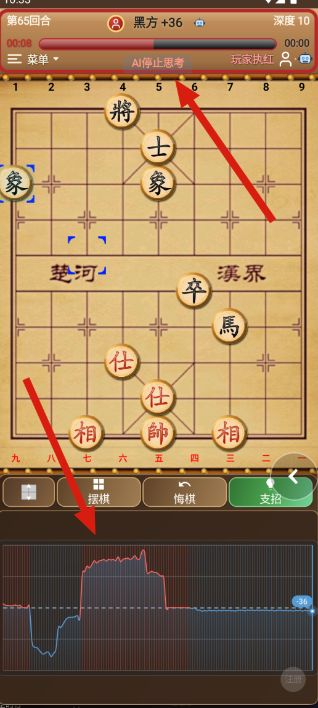

## 十、结束一局

- 将死 / 困毙会直接判负。
- 出现三次重复、长将、长捉等，会提示**和棋**或**变着**；需要认输时也有相应确认。
- 想重新开始，点**新局**即可。

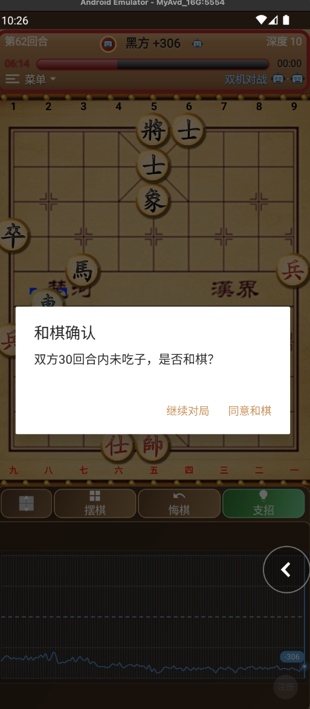

---

就这么简单：选模式 → 点子走子 → 卡壳点支招 → 想研究用拍照识谱或摆棋 → 下完保存复盘。祝你玩得开心！
